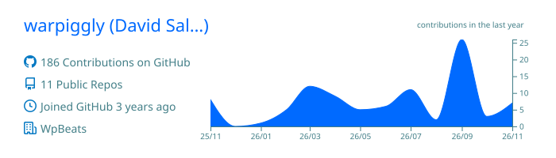
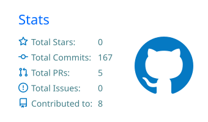
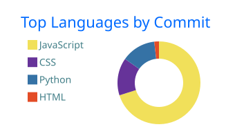

**Data Science · Artificial Intelligence · Music** 
🇨🇴 Medellín, Colombia · Programming technician (CESDE) · Data Science & AI learning path

---

### 👋 About me

I build tools that turn raw data into decisions, and I'm on my way to becoming a **Data Scientist and AI Engineer**. Today I work on BI and data automation: ETL pipelines, dashboards and process automation. Outside the terminal I make music. Chords, patterns and data have more in common than it seems.

> 🇪🇸 Construyo herramientas que convierten datos en decisiones. Trabajo en BI y automatización de datos, y estudio para ser Científico de Datos e Ingeniero en IA. Fuera del código hago música.

- 🔭 Currently building **[Ainur AI](https://github.com/warpiggly/ainur-ai)**: automated EDA plus a chat with your data, powered by LLMs
- 🌱 Learning: machine learning, MLOps, LLM applications
- 🎵 Exploring the overlap between **music and AI** (generative harmony, audio DSP)
- 💬 Ask me about: Python, pandas, data pipelines, Streamlit, browser extensions

---

### 🧰 Tech stack

**Data & AI** 

**Data engineering** 

**Web & tools** 

---

### 🚀 Featured projects

| Project | What it does | Stack |
|---|---|---|
| ✦ **[Ainur AI](https://github.com/warpiggly/ainur-ai)** | Automated EDA and a natural-language chat with any dataset; the AI answers with interactive charts. | Python · Streamlit · Plotly · Claude |
| 🎼 **[HarmonicGen](https://github.com/warpiggly/HarmonicGen)** | Genetic algorithm that evolves musical chord progressions. Goal: a trainable VST plugin. | Python · Evolutionary AI |
| ⛏️ **[DwarfVault](https://github.com/warpiggly/DwarfVault)** | Private, offline text vault for the browser, with semantic search on the roadmap. | JavaScript · Chrome Extension |
| 🐉 **[Dragon Audio](https://github.com/warpiggly/DragonAudio)** | Per-tab audio engine: 600% gain, 5-band EQ, pitch shift, reverb. | JavaScript · Web Audio API |
| 🐴 **[Arriero's Wealth](https://github.com/warpiggly/Arriero-sWealth)** | Helps freelancers and small businesses price their work without underselling. | JavaScript · Chrome Extension |
| 🗂️ **[CleanDesk AI](https://github.com/warpiggly/CleanDesk--AI)** | Desktop file organizer built to grow into AI-driven classification. | Python |

---

### 🎓 Education & certifications

| Institution | Program |
|---|---|
| 🎓 **CESDE** | Programming technician (2 programs) |
| 🧠 **Universidad EAFIT** | Diploma in Artificial Intelligence (2 × 6-month programs) |
| 💻 **edX** | Computer Science for Artificial Intelligence *(in progress)* |
| 📊 **Platzi** | Learning paths: Data Scientist with Python · Machine Learning & Deep Learning · AI-Assisted Graphic Design |
| 🚀 **Polygonus Academy** · **Estud-IA** (Medellín) | AI & software training programs |
| ☁️ **AWS** | 2 digital badges |
| 🎹 **ITM** | Programming for Music certificate |
| 🎛️ **Medellín Music Lab** | Data track *(in progress)* |

---

### 🎵 Music

> *"Creativity has logic, and logic has creativity."*
>
> *"La creatividad tiene lógica y la lógica, creatividad."*

I produce **EDM · Deep House · Tech House · Afro House** as **Warpiggly** and put out **a new release every month**. Selected works: *Nocturne*, *Reverse Season (One)*, *A - Acústico*.

---

### 📊 GitHub stats

